<p align="center">
  
</p>

> *I've seen things you people wouldn't believe.*
> *Hard forks burning off the shoulder of 250 chains.*
> *I watched signing ceremonies glitter in the dark near the KMS gate.*
> *Fifty million in keys, and not one of them lost.*
> *All those moments will be lost in time, like tears in rain…*
> ***unless they're signed, hashed, and anchored on-chain.***

<p align="center">
  
</p>

### ▓ VOIGHT-KAMPFF



```
Q  You find a private key lying in the
   desert sand. What do you do?
A  I don't pick it up. I build a vault
   around it, and give the vault two
   more signers.

Q  An AI agent asks for signing
   authority. Your response?
A  Yes. Out of the box it signs nothing.
   The policy is plain code, with no
   model in it. The model can propose.
   It never decides.

Q  A system is about to fail at 3 a.m.
   Who do you want on call?
A  Whoever wrote the runbook, tested
   the restore, and knows that
   "probably fine" is not a state.

Q  Describe in single words only the
   good things that come into your
   mind about your work.
A  Keys. Thresholds. Proofs. Rain.

── RESULT: inconclusive.
   More human than human.
```

<br clear="right">

### ▓ OFF-WORLD COLONIES

| | |
|---|---|
| **[SAGE](https://github.com/criptografia-app/sage)** | An agentic wallet on Safe. Two AI co-signers, one human, and a policy engine with no model in it. |
| **[deck](https://github.com/metaver5o/deck)** | A 2013 iPad mini, rebuilt as a stream deck that approves my Claude Code agents. |
| **[legacy-sat-auditor](https://github.com/metaver5o/legacy-sat-auditor)** | Mathematically verifies the lineage of sats from the bitcoin++ Austin 2022 workshop. |
| **[xcp-indexer](https://github.com/metaver5o/xcp-indexer)** | An indexer for Counterparty, Bitcoin's oldest token layer. |
| **[GiraRota](https://github.com/metaver5o/girarota)** | A traveling-salesman solver in a courier's phone browser, for delivery riders in Brazil. |
| **[antoni](https://github.com/metaver5o/antoni)** | A reading app where the kid is the author: tell a story out loud, and it becomes the reading game. |

```
  > cryptography ....... post-quantum, ZK, threshold signing, HSMs, FIDO2
  > chains ............. Bitcoin (PSBT, ordinals, Counterparty), EVM, Safe{Core}
  > agents ............. MCP, multi-agent systems that fail closed
  > infrastructure ..... Kubernetes, Terraform, Ansible, AWS, GCP, observability
  > languages .......... Go, Rust, Python, TypeScript, Solidity, Bash
```

<p align="center">
<a href="https://linkedin.com/in/mmatos">LinkedIn</a> ·
<a href="https://criptografia.app">criptografia.app</a> ·
<code>metaver5o.eth</code>
<br><br>
<sub><i>Wake up. Time to build.</i></sub>
</p>
